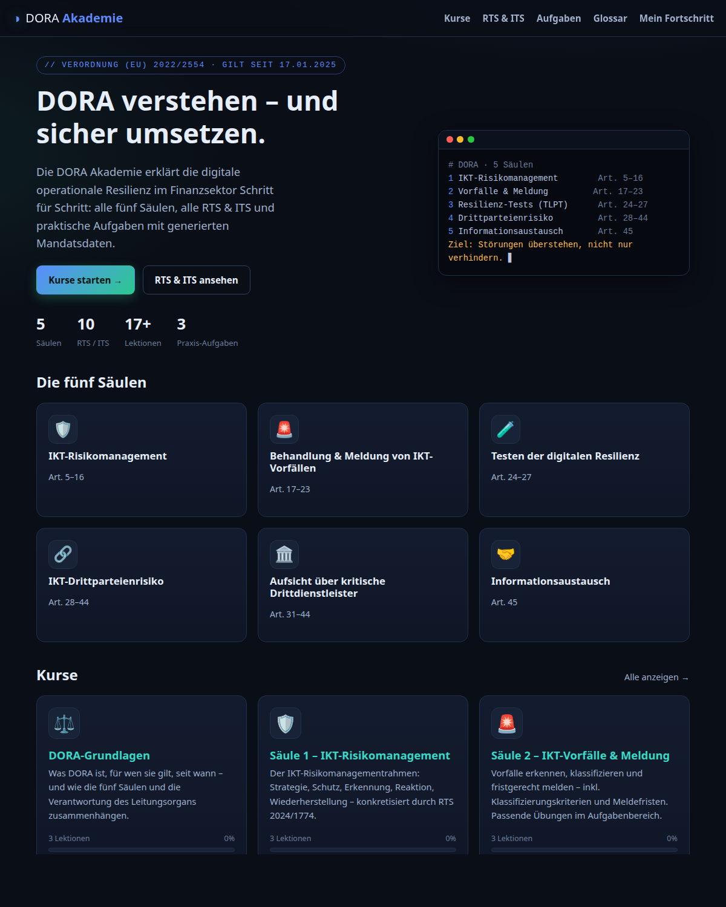

# ⚖️ DORA Akademie – digitale operationale Resilienz lernen

Interaktive Lernplattform zur **Verordnung (EU) 2022/2554 (DORA)** und ihren technischen
Standards – komplett im Browser, ohne Konto, ohne Tracking, ohne Build-Tooling
(reines HTML/CSS/JavaScript). Sofort als statische Seite deploybar (GitHub Pages).

👉 **Live:** https://adminarlnick.github.io/dora-academy/



## Inhalt

- **7 Kurse** zu allen fünf DORA-Säulen + Grundlagen + Aufsicht (CTPP/Oversight),
  jeweils mit Lektionen und Abschluss-Quiz.
- **RTS/ITS-Katalog**: alle verabschiedeten Level-2-Standards mit amtlichem Titel,
  Artikelbezug und Direktlink zu EUR-Lex (2024/1502, 1772, 1773, 1774, 2956;
  2025/295, 301, 302, 532, 1190).
- **3 Praxis-Aufgaben mit generierten Mandatsdaten** (fiktive Finanzunternehmen/Dienstleister):
  - 🚨 Vorfall-Klassifizierung (schwerwiegend ja/nein nach Art. 18 / RTS 2024/1772)
  - ⏱️ Meldefristen-Rechner (Erst-/Zwischen-/Abschlussmeldung)
  - 📒 Informationsregister befüllen (ITS 2024/2956)
- **Fortschritt, Zertifikate, Glossar**, dunkles Design, responsive.

## Lokal starten

```bash
python3 -m http.server 8080   # dann http://localhost:8080
```
Oder einfach `index.html` öffnen. Neue Kurse/Standards = Eintrag in `js/courses.js` bzw.
`js/rts.js` ergänzen – kein Build nötig.

## Aufbau

```
index.html        Gerüst
css/styles.css    Design
js/rts.js         RTS/ITS-Katalog + Säulen (Daten)
js/courses.js     Kurs-/Lektions-/Quiz-Inhalte
js/tasks.js       Aufgaben + Mandatsdaten-Generator
js/app.js         Router, Rendering, Fortschritt
```

## Haftungsausschluss

Didaktisches Angebot **ohne Gewähr**, **keine Rechts- oder Compliance-Beratung**. Die Inhalte
sind vereinfachte Zusammenfassungen; verbindlich sind ausschließlich die amtlichen Texte in
EUR-Lex sowie Leitlinien der ESAs und nationale Konkretisierungen. Die Bewertungslogik der
Aufgaben ist eine offengelegte Heuristik, nicht der amtliche Schwellenwert.

## Lizenz

MIT – siehe [LICENSE](LICENSE).
